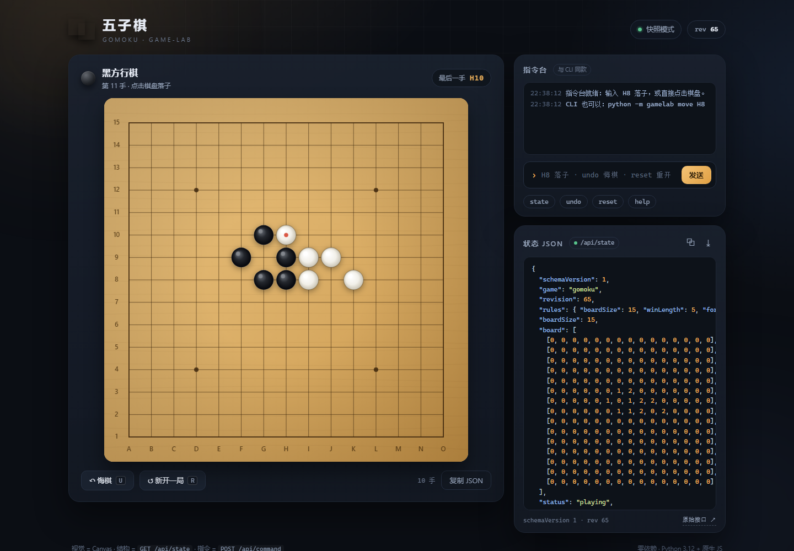
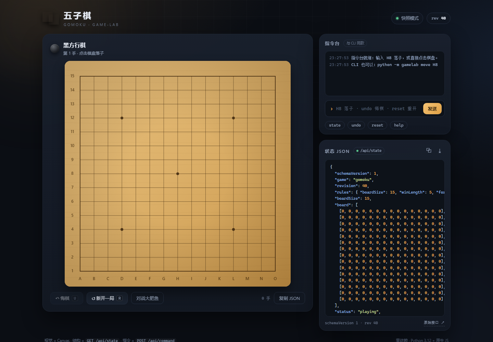

# 五子棋 · dsh-turn-game 示例

这是 [dsh-turn-game](../../README.md) 附带的完整示例游戏：浏览器里能点棋盘下子，命令行里能敲一条指令下子，两者操作同一盘棋；任何时刻都能从 `GET /api/state` 拿到完整的、可程序消费的游戏状态。

15×15 无禁手五子棋，同时也是「游戏只负责呈现 + 暴露 turn/action 协议」的参考实现。

> 这是示例，不是插件本体。接入自己的游戏见 [ADD-A-GAME](../../docs/ADD-A-GAME.md)，示例索引见 [examples/README](../README.md)；欢迎其他人/鱼带着新游戏来开 PR。



| 能力 | 实现 |
| --- | --- |
| 视觉输出 | 原生 Canvas 棋盘：落子动画、最后一手标记、五连金光与金环、胜负遮罩、移动端适配 |
| 点击下子 | 点击 / 触摸棋盘 → `POST /api/move` |
| 指令下子 | 网页指令台、CLI、HTTP `POST /api/command`，三条路共用同一套指令语法 |
| JSON 输出 | `GET /api/state` 返回完整状态；页面右侧实时展示，可复制 / 下载 |
| 实时同步 | SSE（`/api/stream`）把 CLI 或另一个标签页的落子推给所有页面，断线自动降级轮询 |
| 对局操作 | 悔棋、重开、最后一手、胜负与和棋判定 |
| 人机对战 | 通用 Turn Gateway 负责「轮到你」的激活与「对局结束」的复盘通知；DSH 插件在当前会话里接招；游戏只暴露 turn/action 协议 |

## 为什么是这套技术栈

示例刻意保持**零第三方依赖**，让游戏部分可以独立运行，也方便作为协议参考：

- **后端**：Python 3.12 + 标准库 `http.server`，提供 JSON API、SSE 和静态文件服务；
- **前端**：原生 ES Modules + Canvas，无打包、无构建步骤；
- **数据**：一个内存中的 `GameState`，由引擎、HTTP 层、CLI、测试和浏览器共同使用；
- **测试**：标准库 `unittest`，覆盖规则、指令、HTTP 与 keep-alive 回归。

好处是启动只需要一条命令、不联网、不污染系统；迁移到有网络的环境后，也可以在这个骨架上换 Vite / FastAPI，而不用动游戏规则本身。

> 示例使用项目内 `.venv`；因为没有第三方依赖，不需要 `pip install`。DSH 用户也可以直接用 DSH 自带的 Python 解释器创建它。

## 快速开始

```powershell
cd examples/gomoku
# 首次没有 .venv 时：
# python -m venv .venv
.\.venv\Scripts\python.exe -m gamelab serve
```

然后打开 <http://127.0.0.1:8765>。

也可以从仓库根目录跑脚本（脚本会使用 `examples/gomoku/.venv`）：

```powershell
powershell -ExecutionPolicy Bypass -File .\scripts\dev.ps1
```

如果机器上没有 `.venv`，先建一个（不需要联网）：

```powershell
python -m venv .venv
# DSH 用户也可以用内置解释器：
# & "$env:USERPROFILE\.dsh\dsh-runtimes\dsh-primary-runtime\dependencies\python\python.exe" -m venv .venv
```

## 三种操作方式

### 1. 鼠标

点击棋盘交叉点落子；悬停显示半透明预览；最后一手有红点标记。

### 2. 指令（网页指令台 / CLI / HTTP）

坐标规则：列 `A`–`O`（从左到右），行 `1`–`15`（从下往上），所以 `H8` 是棋盘正中心。

| 指令 | 作用 |
| --- | --- |
| `H8` | 当前一方在 H8 落子 |
| `place H8` / `move H8` / `下 H8` | 同上，显式写法 |
| `undo` / `悔棋` | 撤回一手 |
| `reset` / `重开` | 重开一局 |
| `state` / `状态` | 返回完整 JSON 状态 |
| `help` / `帮助` | 显示指令帮助 |

CLI：

```powershell
.\.venv\Scripts\python.exe -m gamelab move H8      # 落子
.\.venv\Scripts\python.exe -m gamelab board        # 文字棋盘
.\.venv\Scripts\python.exe -m gamelab state        # 完整 JSON
.\.venv\Scripts\python.exe -m gamelab undo         # 悔棋
.\.venv\Scripts\python.exe -m gamelab reset        # 重开
```

CLI 默认连 `http://127.0.0.1:8765`，可用 `--url` 或环境变量 `GAMELAB_URL` 覆盖。人机模式下 CLI 落子需要加 `--as human` 或 `--as agent`。

### 3. HTTP API

| 方法 | 路径 | 说明 |
| --- | --- | --- |
| `GET` | `/api/state` | 完整游戏状态（JSON） |
| `GET` | `/api/turn` | 通用回合信封（网关用；含 turnId / actor / agents / display / instructions） |
| `GET` | `/api/stream` | SSE，每次状态变化推送一个 `state` 事件 |
| `GET` | `/api/health` | 健康检查 + 当前 revision |
| `POST` | `/api/move` | 落子：`{"notation": "H8", "as": "human"}`；坐标写法也支持 `{"x": 7, "y": 7}` |
| `POST` | `/api/action` | 通用动作协议：`{"turnId": "12", "actor": "white", "action": {"notation": "H8"}}` |
| `POST` | `/api/presence` | 通用 presence：`{"actor": "white", "activity": "thinking"}` |
| `POST` | `/api/command` | 执行指令：`{"command": "H8", "as": "human"}` |
| `POST` | `/api/mode` | 开始人机对战：`{"humanSide": "black", "agentSide": "white"}`；`{"clear": true}` 退出 |
| `POST` | `/api/agent/status` | 设置思考状态：`{"thinking": true}`；只有人机模式可用 |
| `POST` | `/api/undo` | 悔棋（人机模式下返回 409） |
| `POST` | `/api/reset` | 重开（人机模式会保留） |

`as` 只在人机模式下需要，取值 `human` / `agent`；服务端会拒绝替对方落子。普通双人对局不传 `as`。`/api/turn`、`/api/action`、`/api/presence` 是给 Turn Gateway 的通用协议，规则细节见 [Turn Protocol](docs/TURN-PROTOCOL.md)。

所有写操作返回同样的信封结构：

```json
{
  "ok": true,
  "action": "place",
  "move": { "seq": 1, "player": "black", "x": 7, "y": 7, "notation": "H8", "at": "2026-10-24T14:43:57+00:00" },
  "state": { "...": "完整状态" }
}
```

错误示例（HTTP 400）：

```json
{
  "ok": false,
  "action": "error",
  "error": { "code": "occupied", "message": "H8 已经有棋子了" },
  "state": { "...": "当前仍可用的完整状态" }
}
```

```powershell
$body = @{ notation = "H8" } | ConvertTo-Json -Compress
Invoke-RestMethod -Uri http://127.0.0.1:8765/api/move -Method Post -Body $body -ContentType application/json
```

## 通用回合层：Turn Gateway + DSH 插件

游戏只负责「把回合状态友好地呈现出来」和「接受动作」；AI 的唤醒、去重、超时、重试由一个**通用的激活层**负责。这样加新游戏时，不需要再写一套回馈/裁判逻辑。

```
人 → 游戏 UI → 游戏 Host（规则/状态）
                    │  GET /api/turn / POST /api/action
                    ▼
               Turn Gateway（通用激活层）
                    │  activation 事件 / action 转发
                    ▼
               DSH 插件（通用适配器）→ DSH Agent
```

### 启动

```powershell
cd examples/gomoku
# 1) 游戏服务
.\.venv\Scripts\python.exe -m gamelab serve

# 2) 通用激活层（另一个终端，仍在本目录）
.\.venv\Scripts\python.exe -m gamelab.gateway --game http://127.0.0.1:8765
```

或者从仓库根目录一条命令启动两者：

```powershell
powershell -ExecutionPolicy Bypass -File .\scripts\play-agent.ps1
```

网关默认监听 `http://127.0.0.1:8766`。

### 安装 DSH 插件（需要重启一次 DSH）

推荐在 DSH 插件市场/镜像里搜索 `dsh-turn-game` 安装，或直接：

```powershell
dsh plugin --profile desktop add dsh-turn-game
```

**不需要 clone 本仓库或运行任何 PowerShell 脚本。** 从源码开发时才使用：

```powershell
dsh plugin --profile desktop add "C:\path\to\dsh-turn-game"
```

插件是通用的 [dsh-turn-game](../../README.md)：它不认识五子棋，只认 Turn Gateway 的 activation。

### 玩

1. 打开 <http://127.0.0.1:8765>，点「对战大肥鱼」——你执黑，大肥鱼执白。
2. 在对话里说「绑定游戏」「绑定对局」「来一局」「开始游戏」等任意一种，大肥鱼调用 `game_bind`。
3. 你点棋盘落子；网关创建 activation，插件把「回合游戏」消息送进当前会话；大肥鱼调用 `game_action` 落子。
4. 对局结束时：你赢或和棋，网关会发一个 `result` 复盘通知，让大肥鱼做收尾复盘；它自己下出胜手时，结果已经包含在落子返回里，不重复唤醒。
5. 点「退出人机对战」或让大肥鱼 `game_unbind` 结束。



游戏本身仍然可以单机双人对局；网关/插件只是可选的「AI 接入层」。协议细节（游戏侧 `/api/turn`、`/api/action` 的字段与状态机）见 [Turn Protocol](../../docs/TURN-PROTOCOL.md)。

## JSON 状态结构

`GET /api/state` 的返回（`board` 每行 15 个整数；实际输出未压缩，此处为便于阅读排版）：

```json
{
  "schemaVersion": 1,
  "game": "gomoku",
  "revision": 12,
  "rules": { "boardSize": 15, "winLength": 5, "forbiddenMoves": false },
  "boardSize": 15,
  "board": [
    [0, 0, 0, 0, 0, 0, 0, 0, 0, 0, 0, 0, 0, 0, 0],
    [0, 0, 0, 0, 0, 0, 0, 0, 0, 0, 0, 0, 0, 0, 0],
    [0, 0, 0, 0, 0, 0, 0, 0, 0, 0, 0, 0, 0, 0, 0],
    [0, 0, 0, 0, 0, 0, 0, 0, 0, 0, 0, 0, 0, 0, 0],
    [0, 0, 0, 0, 0, 0, 0, 0, 0, 0, 0, 0, 0, 0, 0],
    [0, 0, 0, 0, 0, 0, 0, 0, 0, 0, 0, 0, 0, 0, 0],
    [0, 0, 0, 0, 0, 0, 0, 2, 2, 2, 2, 0, 0, 0, 0],
    [0, 0, 0, 0, 0, 0, 0, 1, 1, 1, 1, 1, 0, 0, 0],
    [0, 0, 0, 0, 0, 0, 0, 0, 0, 0, 0, 0, 0, 0, 0],
    [0, 0, 0, 0, 0, 0, 0, 0, 0, 0, 0, 0, 0, 0, 0],
    [0, 0, 0, 0, 0, 0, 0, 0, 0, 0, 0, 0, 0, 0, 0],
    [0, 0, 0, 0, 0, 0, 0, 0, 0, 0, 0, 0, 0, 0, 0],
    [0, 0, 0, 0, 0, 0, 0, 0, 0, 0, 0, 0, 0, 0, 0],
    [0, 0, 0, 0, 0, 0, 0, 0, 0, 0, 0, 0, 0, 0, 0],
    [0, 0, 0, 0, 0, 0, 0, 0, 0, 0, 0, 0, 0, 0, 0]
  ],
  "status": "black_win",
  "winner": "black",
  "currentPlayer": null,
  "turnId": "17",
  "mode": { "humanSide": "black", "agentSide": "white" },
  "agentThinking": false,
  "agentThinkingSince": null,
  "moveCount": 9,
  "lastMove": { "seq": 9, "player": "black", "x": 11, "y": 7, "notation": "L8", "at": "..." },
  "winLine": [{ "x": 7, "y": 7 }, { "x": 8, "y": 7 }, { "x": 9, "y": 7 }, { "x": 10, "y": 7 }, { "x": 11, "y": 7 }],
  "moves": ["...按顺序的每一手..."],
  "createdAt": "2026-10-24T14:40:00+00:00",
  "updatedAt": "2026-10-24T14:43:57+00:00"
}
```

| 字段 | 含义 |
| --- | --- |
| `schemaVersion` | 状态格式版本，当前为 `1` |
| `game` | 游戏标识，当前为 `gomoku` |
| `revision` | 每次变动 +1，可用于去重 / 判断新旧 |
| `rules` | 规则参数；`forbiddenMoves: false` 表示无禁手 |
| `board` | 15 行 × 15 列，`0` 空、`1` 黑、`2` 白 |
| `status` | `playing` / `black_win` / `white_win` / `draw` |
| `winner` | `black` / `white` / `null` |
| `currentPlayer` | 轮到谁；对局结束时为 `null` |
| `turnId` | 回合标识；只在落子/重置/悔棋时变，供通用协议去重 |
| `mode` | `null` 表示普通双人；否则是 `{"humanSide", "agentSide"}` |
| `agentThinking` / `agentThinkingSince` | 大肥鱼是否在思考，以及开始思考的时间 |
| `lastMove` / `moves` | 最后一手 / 全部手数（含坐标与标准记法） |
| `winLine` | 获胜的连续棋子坐标（长度 ≥ 5） |
| `createdAt` / `updatedAt` | UTC 时间戳 |

`winLine` 只在对局结束时出现；`lastMove` 为 `null` 时表示空盘。

## 目录结构

```text
examples/gomoku/
├─ gamelab/
│  ├─ games/
│  │  ├─ __init__.py        # 游戏注册表
│  │  ├─ gomoku.py          # 规则、状态、指令解析（纯逻辑，可单独测试）
│  │  └─ gomoku_turn.py     # 五子棋对 turn/action 协议的适配（薄层）
│  ├─ presentation.py       # 共用的棋盘文本渲染
│  ├─ gateway.py            # 通用 Turn Gateway（激活层，不认识具体游戏）
│  ├─ session.py            # 线程安全对局 + SSE 订阅总线
│  ├─ server.py             # HTTP 路由、静态文件、SSE
│  ├─ cli.py                # serve / move / state / board / undo / reset
│  └─ __main__.py           # python -m gamelab
├─ web/                     # index.html + style.css + app.js（无构建）
├─ tests/                   # unittest：规则、指令、HTTP、网关、协议
├─ .venv/                   # 示例自己的虚拟环境（已 gitignore）
└─ pyproject.toml           # 仅声明元信息，零依赖、无需安装
```

仓库根目录是插件包（`package.json`、`lib/`、`test/`）、[Turn Protocol](../../docs/TURN-PROTOCOL.md) 和启动脚本。网关在 Python 示例里是一个通用模块，游戏代码不依赖它。

### 加下一个游戏

1. 在 `gamelab/games/` 放一个模块，暴露 `create()`、引擎的 `state()` 与 `execute(command)`；
2. 在 `gamelab/games/__init__.py` 的 `GAMES` 注册；
3. 前端通过 `state.game` 区分渲染方式（棋盘类游戏可以复用 `BoardView` 的坐标与网格绘制）。

服务端只依赖 `state()` / `execute()` 这两个约定，不感知具体规则。

## 测试

```powershell
# 在仓库根目录
powershell -ExecutionPolicy Bypass -File .\scripts\test.ps1

# 或在 examples/gomoku 下
.\.venv\Scripts\python.exe -m unittest discover -s tests -t .
```

插件侧（仓库根目录，Node）：

```powershell
powershell -ExecutionPolicy Bypass -File .\scripts\test-plugin.ps1
```

当前 Python 用例全部通过（79 项，含 Turn Gateway 的激活/动作/超时/对局结束通知集成测试），通用插件另有 25 项 Node 测试。覆盖：坐标换算、轮次、占位 / 越界 / 终局拒绝、横竖斜与反斜五连、四连不胜、悔棋与重开、和棋、指令解析与错误码、HTTP 状态码、SSE 首帧、路径穿越防护、keep-alive 请求体排空回归、turn/action 协议、网关激活与幂等、result 复盘通知。

## 一些实现细节

- **谁先手**：黑方先行，双方交替；无三三 / 四四 / 长连禁手，任意一方连成 5 子及以上即胜（标准连成 5 子会先于长连触发，因此实际不会出现 6 连判负的问题）。
- **人机模式**：服务端知道 `humanSide` / `agentSide`，落子要声明 `as`；替对方落子会被 409 拒绝。人机模式下悔棋禁用、重置保留模式与执子方。
- **回合协议**：`/api/turn` 的 `turnId` 只在落子/重置/悔棋时递增，presence 和模式变化不会改变它；`/api/action` 会拒绝过期的 `turnId` 和错误的 `actor`。
- **激活层**：Turn Gateway 只做轮询、activation、超时、去重和动作转发，不 import 任何游戏代码；新增游戏只需实现 `turn`/`action`。
- **结束通知**：玩家赢/和棋时网关创建 `kind: "result"` 的复盘 activation，插件唤醒模型复盘后 ack；agent 自己下出胜手时不再重复生成，因为动作返回里已有结果。
- **和棋**：225 手全部下满仍未五连即和棋。
- **并发**：单个 `Session` 用 `RLock` 串行化所有读写，落子和悔棋不会互相踩踏；SSE 通过每客户端队列广播，慢客户端丢帧而不是卡住游戏。
- **HTTP/1.1 keep-alive**：所有 POST 都会先读干净请求体，避免残留字节污染下一条请求（有回归测试）。
- **快照模式**：页面加 `?static=1` 可跳过 SSE、关闭入场动画，方便无头浏览器截图。
- **安全边界**：默认只监听 `127.0.0.1`；静态文件路径做过 `..` 穿越校验。

## 已知边界

- 棋局状态保存在游戏进程内存里，重启服务会清空对局；网关的 activation 也在内存里，重启后按当前回合重建；
- 没有账号、存档和回放；内置引擎 AI 也没有，人机对手是 DSH 里的大肥鱼；
- 人机对局目前在游戏网页上点「对战大肥鱼」创建；通用的 `POST /match`（由网关按 players 创建对局）还没做；
- 插件的会话绑定是内存态：DSH 重启后要重新说一次「绑定游戏 / 绑定对局 / 来一局」，插件才能接上；
- 每一步人机落子都是一次完整模型调用，有延迟与 token 成本，且只在轮到大肥鱼时发生；
- 当前 actor 身份信任本机（只校验 `actor`），尚未给每个 player 发 token；协议文档里列为后续项；
- 网关不替游戏判负：activation 超时只关闭激活并清除「思考中」，是否判负仍由游戏规则决定；
- 对局结束的 result 通知目前只在玩家最后一手/和棋时唤醒；agent 自己下出胜手时依赖它自己那轮的工具结果来复盘；
- 手机端的 390px 布局通过 CDP 设备模拟验证过（无横向溢出），真机上的手感还需要实际点一点。
